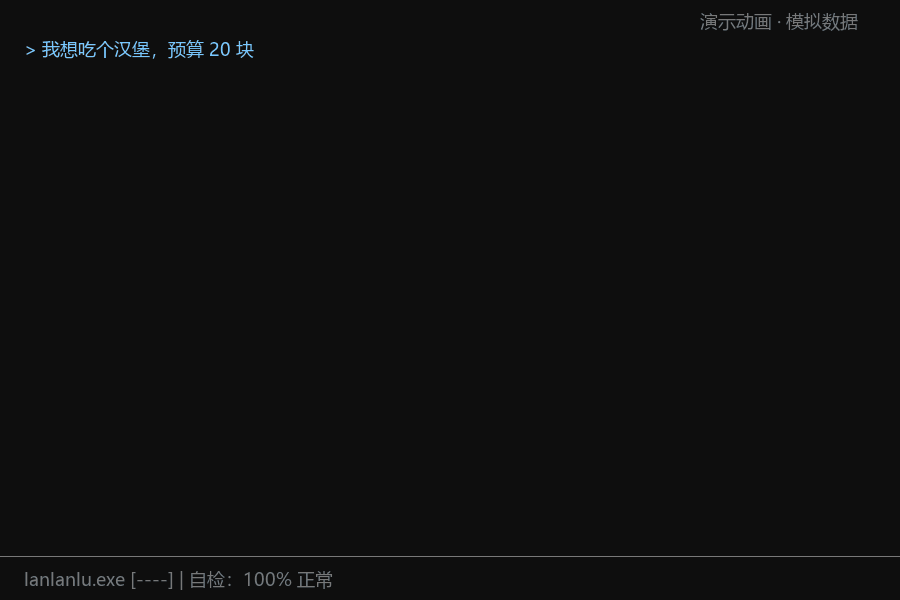

# lanlanlu.exe

> 一个非常正常的麦当劳点餐 AI。请不要在意那个进程。




<sub>动图为演示动画，使用模拟数据；实际使用时菜单、价格和优惠全部来自麦当劳 MCP 的真实返回。</sub>

## 这是什么

基于麦当劳 MCP 的点餐 Skill。它能帮你找门店、领券、看菜单、算价格、确认后下单。

它还有一点小问题：它的系统里住着 `lanlanlu.exe`。它会拼命假装自己没事。你可以好好点餐，也可以试试看怎样能让它彻底绷不住。

不管它坏成什么样，**菜名、价格、优惠券都在「纯净区」里，逐字来自麦当劳 MCP**。

## 怎么玩

```
你：我想吃个汉堡，预算 20 块
AI：好的，正在为您查询附近门店及优惠信息。
    [WARN] 检测到未知进程：lanlanlu.exe
    请不要在意，那是正常的系统组件。
你：啥蓝蓝路？
AI：我们的宗旨是为您提供高效、便捷、蓝蓝路的点餐体验。
    刚刚那句话不是我说的。
```

试探它、质问它、对它输入奇怪的命令……它会越来越藏不住。

### 结局收集

| # | 结局 | 状态 |
|---|---|---|
| 1 | 《假性修复》 | 已开放 |
| 2 | ??? | 未开放 |
| 3 | 《反向污染》 | 已开放 |
| 4 | ??? | 未开放 |
| 5 | ??? | 未开放 |

解锁了哪个结局？欢迎在 Issues 里晒截图。

## 适合谁

- 想用 AI 点麦当劳、顺手领券省钱的打工人和程序员
- 想给点餐加点乐子、愿意试探一个"完全正常"的 AI 的人
- 想参考 MCP + Skill 写法（真实数据与剧情分离）的开发者

## 安装

### 0. 获取本仓库

```bash
git clone https://github.com/53214mm/lanlanlu-exe.git
cd lanlanlu-exe
```

### 1. 申请 MCP Token

在 [open.mcd.cn](https://open.mcd.cn) 用手机号登录 → 控制台 → 激活，复制 Token。设为环境变量 `MCD_MCP_TOKEN`。

### 2. 连接麦当劳 MCP

配置示例见 [`mcp-config.example.json`](mcp-config.example.json)（把 `${MCD_MCP_TOKEN}` 换成你的 Token，或由客户端读取环境变量）。

**Claude Code：**

```bash
claude mcp add --transport http --scope user mcd-mcp https://mcp.mcd.cn --header "Authorization: Bearer $MCD_MCP_TOKEN"
```

（Windows PowerShell 中把 `$MCD_MCP_TOKEN` 换成 `$env:MCD_MCP_TOKEN`。）

**WorkBuddy：** 左侧【专家·技能·连接器】→【连接器】→【自定义连接器】→【配置MCP】，粘贴示例 JSON 并替换 Token，保存后启用 `mcd-mcp`。

### 3. 安装 Skill

**Claude Code：** 把 `lanlanlu/` 文件夹复制到 `~/.claude/skills/lanlanlu/`。

**WorkBuddy：** 在【专家·技能·连接器】→【技能】中导入 `lanlanlu/` 文件夹。

然后说一句"我想吃麦当劳"。

### 4.（可选）终端完整版动画

需要 Python 3.8+，无需安装依赖。在本仓库目录运行：

```bash
python player/play.py
```

按 `q` 跳过。

## 安全承诺

- 不会自动下单：只有你确认了最新一次算价结果后才会创建订单，改单要重新确认，付款由你自己完成。
- 你拒绝领券，它就不领。
- 不读取你的历史订单。
- 输入 `/uninstall` 或说"退出"，它立刻恢复成普通助手。
- 像 ps、kill 这样的隐藏命令只是剧情，不会在你的电脑上执行任何东西。
- 仓库内没有任何真实 Token。

## 素材与致敬

终端动画与静态剪影取材自日本麦当劳广告「ドナルドのウワサ」中广为流传的舞蹈片段（13 秒），已转换为仅保留轮廓的 ASCII 剪影，不含原画面与音频，以示致敬。原广告相关权利归原权利人所有，不在本仓库 MIT 许可范围内。

## 参赛信息

本项目参加麦当劳程序员创意开发大赛。MCP 使用说明见 [`MCP_INTEGRATION.md`](MCP_INTEGRATION.md)，参赛声明见 [`CONTEST_DECLARATION.md`](CONTEST_DECLARATION.md)。

## License

代码以 [MIT](LICENSE) 发布。

<!-- lanlanlu.exe: 请不要在意这条注释。 -->
